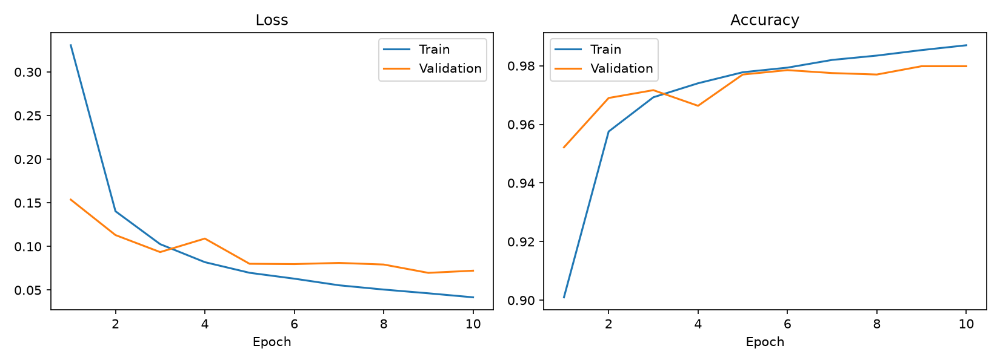
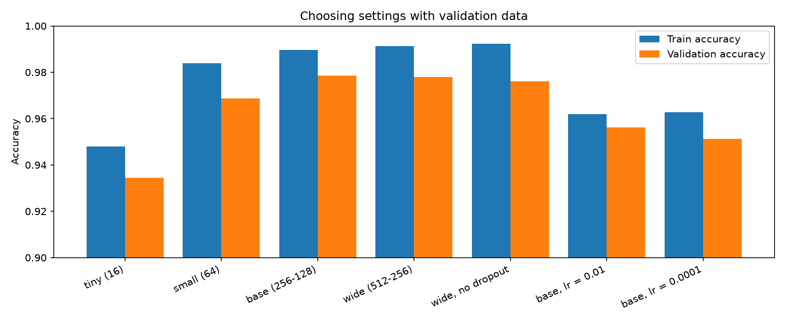
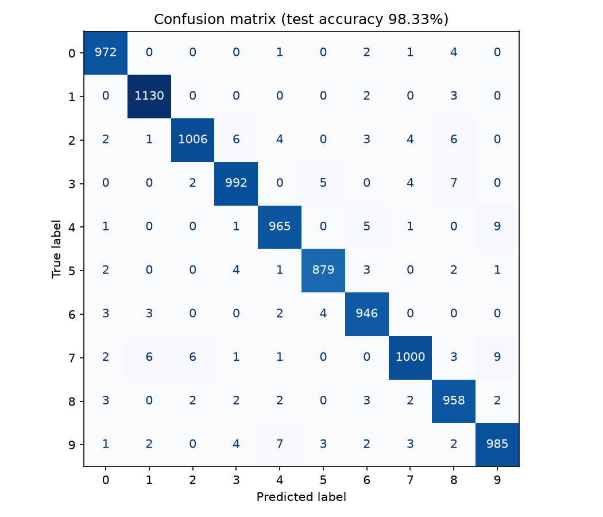
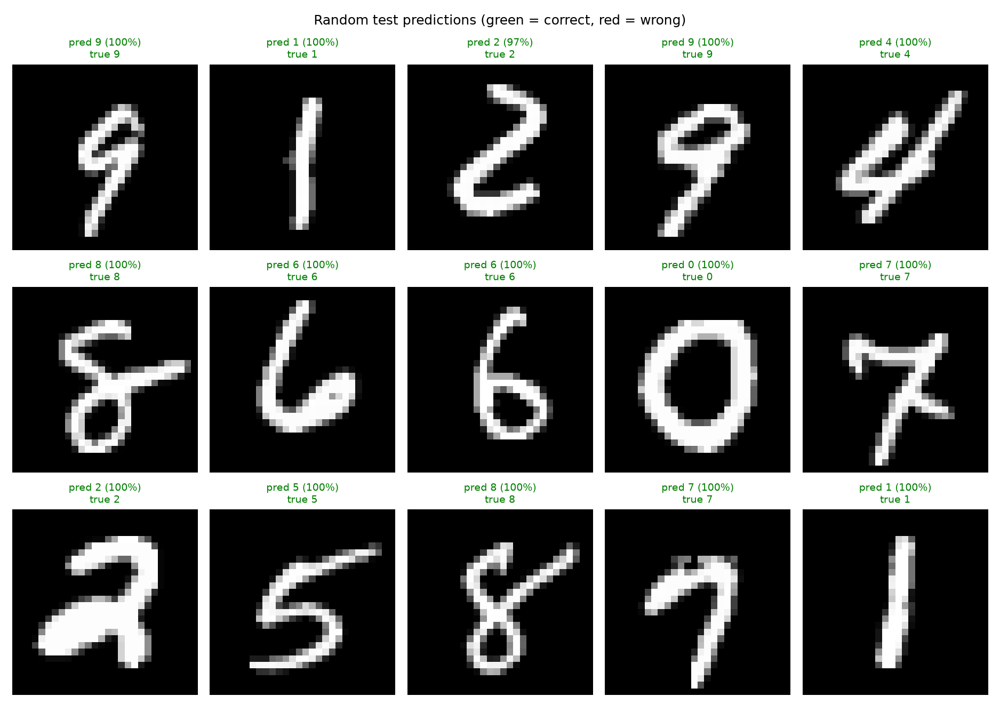
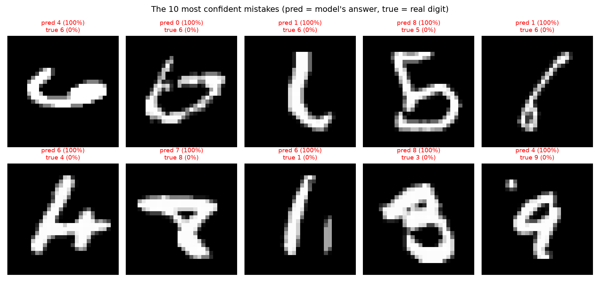
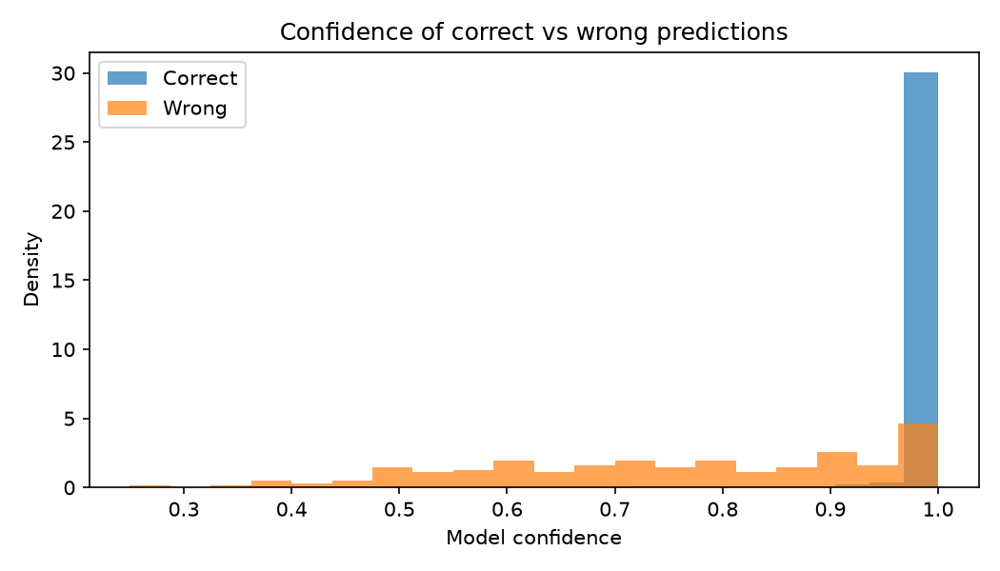
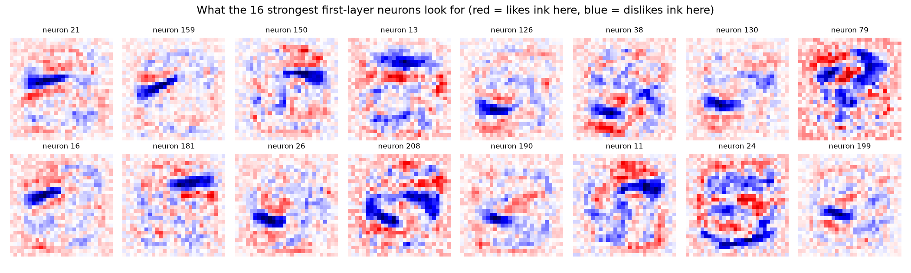
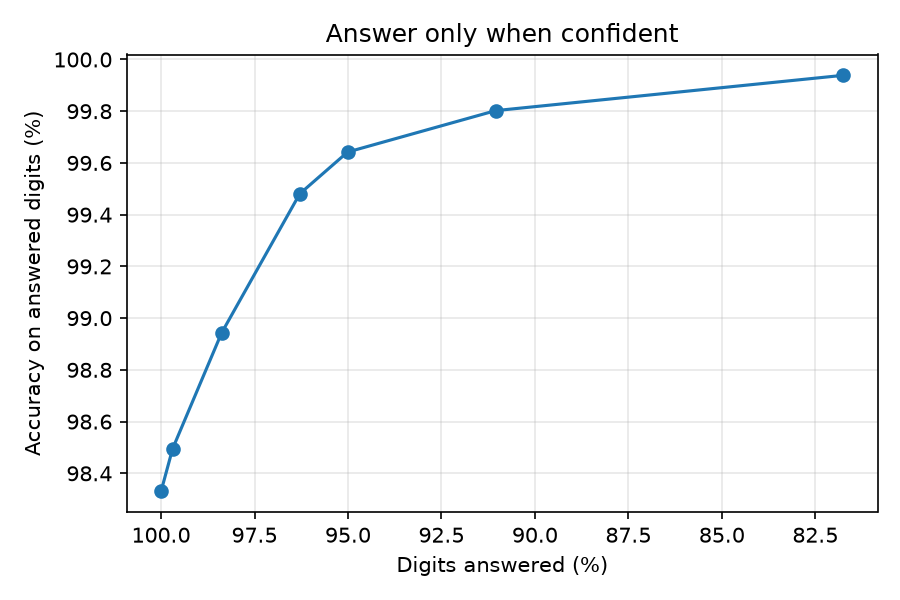
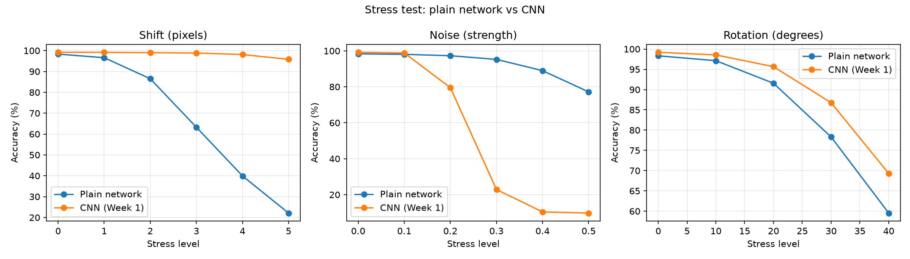

# Digit Lab: A Fully Connected Neural Network on MNIST

Week 2 mini project of the Deep Learning & AI Internship (NEXIS Solutions).

A fully connected neural network (784 -> hidden layers -> 10) is trained to recognize handwritten digits from MNIST. Besides the required test metrics, the project examines how the network fails, what its neurons look for, how its confidence behaves, and how it compares with the CNN from Week 1 when digits are shifted, noisy or rotated.

## Results

| Metric | Value |
|--------|-------|
| **Test accuracy** | **98.33%** |
| Chosen setting | base (256-128) |
| Best validation accuracy | 97.98% |
| Wrong test predictions | 167 of 10,000 |

## Required features

| Requirement | Where |
|-------------|-------|
| Predict digits 0-9 | Parts 2-3 |
| Sample predictions | Part 5 (picture below) |
| Test accuracy and confusion matrix | Part 4 |
| At least five wrong predictions with reasons | Part 5 |

## Training curves

## Choosing settings with validation data

| Setting | Parameters | Train acc | Validation acc | Gap (points) |
|---------|-----------|-----------|----------------|--------------|
| tiny (16) | 12,730 | 94.79% | 93.43% | 1.36 |
| small (64) | 50,890 | 98.39% | 96.87% | 1.53 |
| base (256-128) | 235,146 | 98.97% | 97.85% | 1.12 |
| wide (512-256) | 535,818 | 99.14% | 97.80% | 1.34 |
| wide, no dropout | 535,818 | 99.22% | 97.62% | 1.61 |
| base, lr = 0.01 | 235,146 | 96.20% | 95.62% | 0.58 |
| base, lr = 0.0001 | 235,146 | 96.27% | 95.13% | 1.13 |

## Confusion matrix (10,000 test images)

## Sample predictions

## Error analysis

The 10 most confident mistakes:

- Average confidence: 0.99 when correct, 0.76 when wrong.
- 50 of the 167 mistakes were made with more than 90% confidence.
- Most frequent confusions: 7 read as 9 (9 times), 4 read as 9 (9 times), 9 read as 4 (7 times).
- Hardest digit: 7 (2.72% error rate).
- Likely reasons: ambiguous or sloppy handwriting, digits with similar shapes, no sense of pixel neighbourhood in a fully connected network, unusual writing styles, and a few unclear or mislabeled images.

## Extra experiments

### What each hidden neuron looks for

### Does the network know when it is unsure?

### Stress test: plain network vs Week 1 CNN

| Test | Hardest level | Plain network | CNN |
|------|---------------|---------------|-----|
| Shift (pixels) | 5 | 22.1% | 95.8% |
| Noise (strength) | 0.5 | 77.2% | 9.8% |
| Rotation (degrees) | 40 | 59.5% | 69.3% |

The Week 1 CNN was trained with augmentation and this network was not, so part of the gap comes from training as well as the architecture.

## Run it

From the repository root:

    python -m venv venv
    source venv/bin/activate
    python -m pip install -r Week-01/Mini-Project/requirements.txt ipykernel

Then open `Week-02/Mini-Project/digit_lab.ipynb`, select the `venv` kernel and run all cells. Part 7 loads the Week 1 CNN weights from `Week-01/Mini-Project/digit_cnn.pth`.
