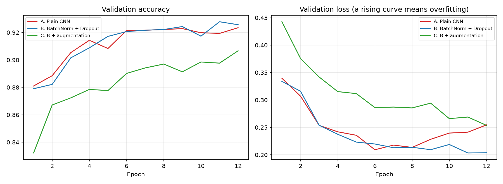
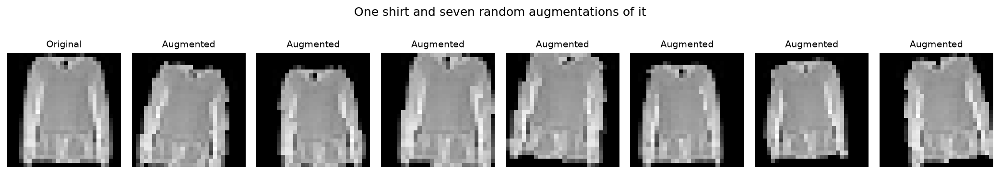
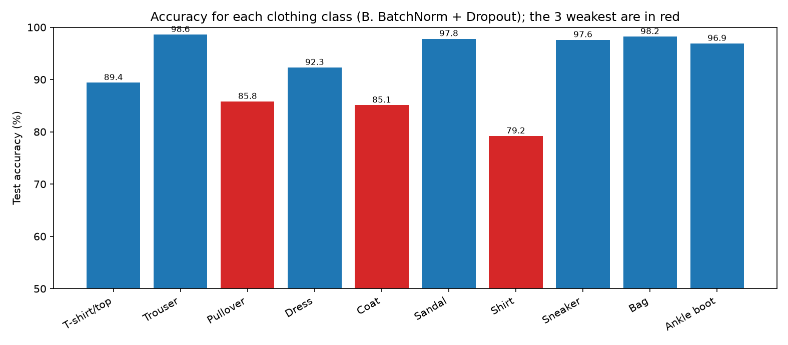
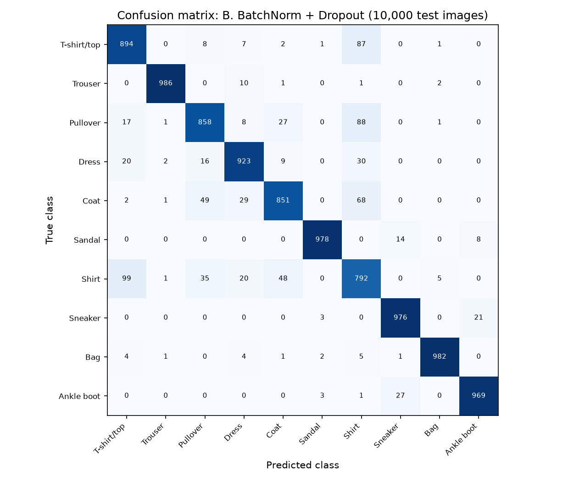
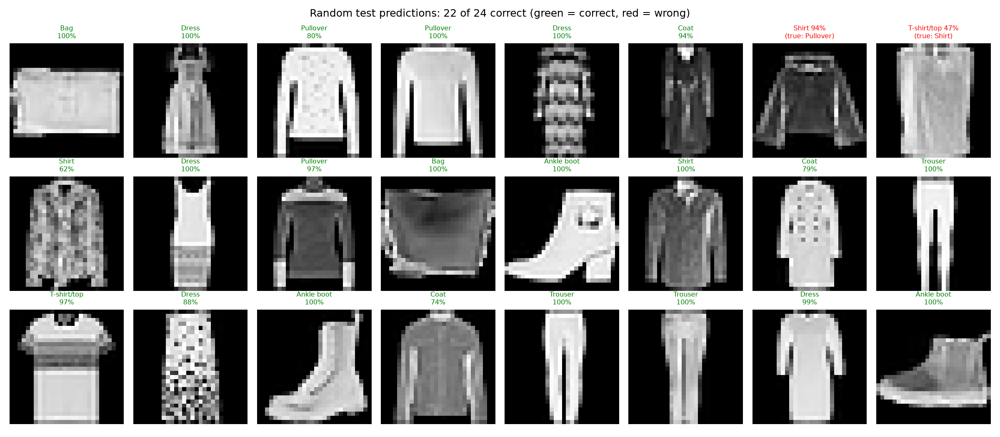
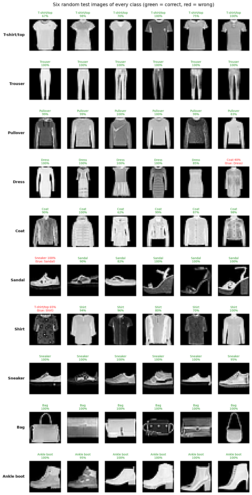
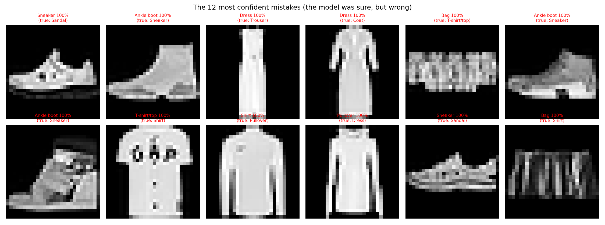
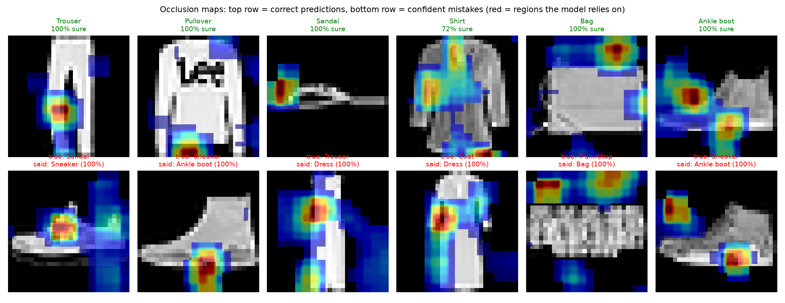

# Fashion Item Recognition: CNNs on Fashion-MNIST

Week 3 mini project of the Deep Learning & AI Internship (NEXIS Solutions).

A convolutional neural network classifies clothing images into 10 categories (T-shirt/top, trouser, pullover, dress, coat, sandal, shirt, sneaker, bag, ankle boot). Three CNN versions are compared, the best one is chosen on validation data and saved, and its mistakes and attention are studied.

## Results

| Metric | Value |
|--------|-------|
| **Chosen model** | B. BatchNorm + Dropout |
| **Test accuracy** | **92.09%** |
| Validation accuracy | 92.78% |
| Wrong test predictions | 791 of 10,000 |
| Saved model | `fashion_cnn.pth` (reload gives identical predictions: True) |

## Required output

| Requirement | Where |
|-------------|-------|
| Working notebook | `fashion_recognizer.ipynb` |
| Comparison table | below and `comparison_table.csv` |
| Prediction gallery | below |
| Saved model | `fashion_cnn.pth` |

## Comparison table

| Version | Parameters | Train acc | Validation acc | Test acc | Gap (points) |
|---------|-----------|-----------|----------------|----------|--------------|
| A. Plain CNN | 421,642 | 98.17% | 92.35% | 91.97% | 5.8 |
| B. BatchNorm + Dropout | 421,834 | 95.69% | 92.78% | 92.09% | 2.9 |
| C. B + augmentation | 421,834 | 91.52% | 90.67% | 90.28% | 0.9 |

Augmentation used for version C (training images only):

## Per-class accuracy

Weakest classes: Shirt (79.2%), Coat (85.1%), Pullover (85.8%). Strongest classes: Trouser (98.6%), Bag (98.2%), Sandal (97.8%).

## Confusion matrix (10,000 test images)

Most frequent confusions: Shirt read as T-shirt/top (99 times), Pullover read as Shirt (88 times), T-shirt/top read as Shirt (87 times).

## Prediction gallery

Random test predictions (green = correct, red = wrong):

Six examples of every class:

The most confident mistakes:

Average confidence is 0.95 for correct predictions and 0.69 for wrong ones, but 128 wrong predictions were made with more than 90% confidence.

## What does the model look at?

Occlusion maps: a gray square is slid over the image, and the drop in the model's confidence shows which regions matter (red = important).

## Using the saved model

    checkpoint = torch.load("fashion_cnn.pth", map_location="cpu")
    model = FashionCNN(**checkpoint["model_config"])
    model.load_state_dict(checkpoint["model_state"])
    model.eval()

The checkpoint also stores the class names and the normalization values (mean and std). The model was trained on small 28x28 grayscale pictures of single garments, so photos with busy backgrounds can be classified less reliably.

## Run it

From the repository root:

    python -m venv venv
    source venv/bin/activate
    python -m pip install -r Week-01/Mini-Project/requirements.txt ipykernel

Then open `Week-03/Mini-Project/fashion_recognizer.ipynb`, select the `venv` kernel and run all cells. Fashion-MNIST is downloaded automatically.
