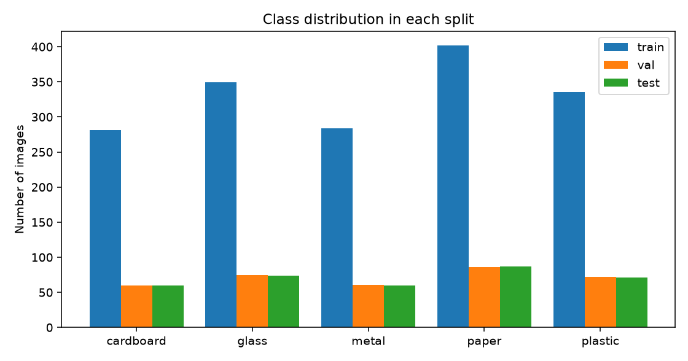
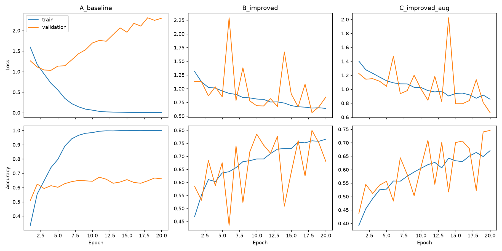
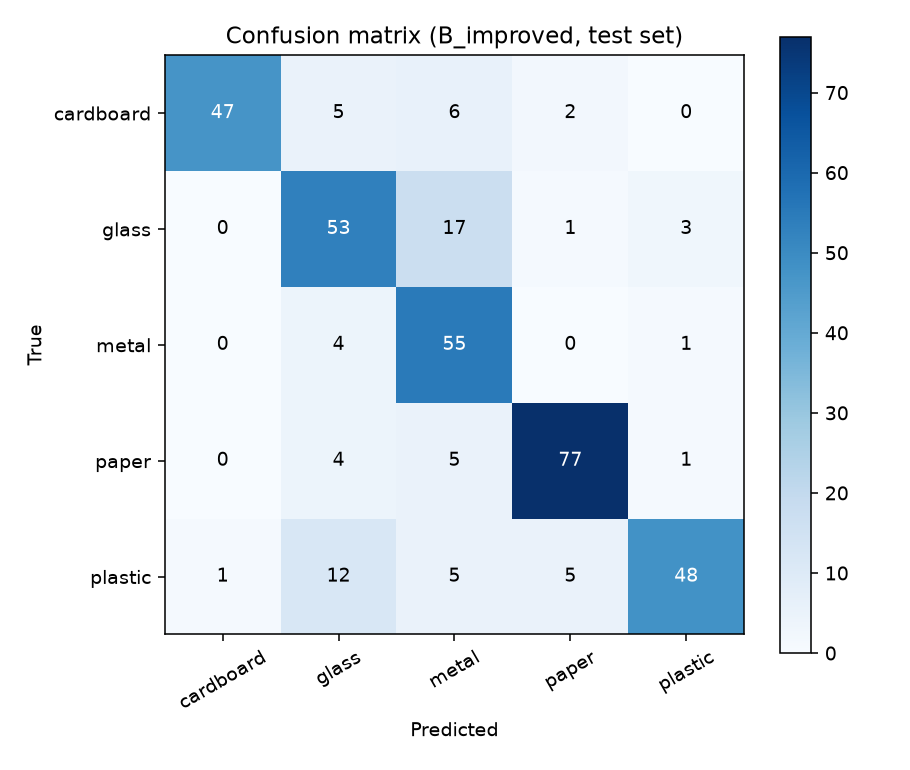
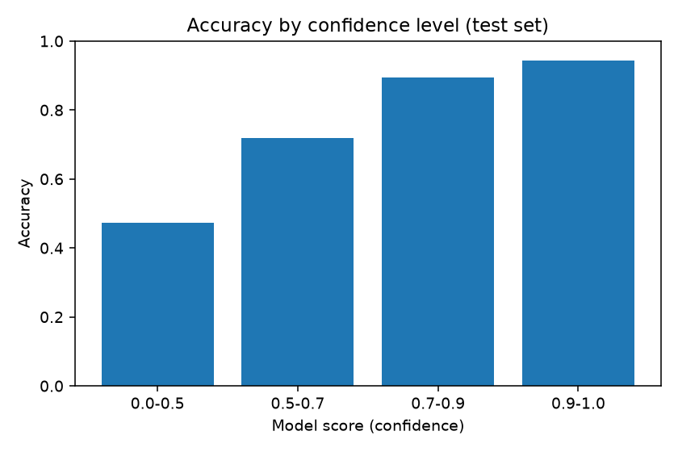
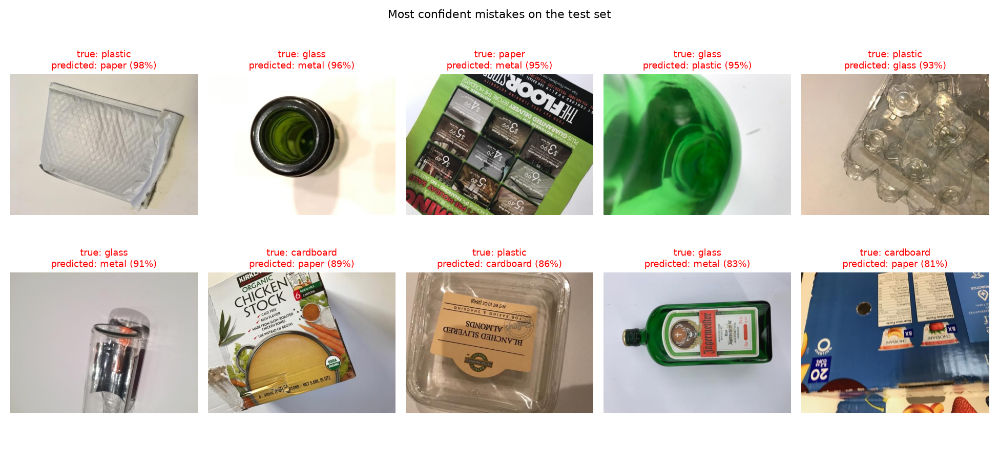

# Assignment 4: Final Model Evaluation

Project: Waste Image Classification System (5 classes), built with PyTorch.
Code, model and app are in `../Mini-Project/`.

## 1. Dataset, class distribution and split sizes

- **Source:** TrashNet (`garythung/trashnet` on Hugging Face, file `dataset-resized.zip`), MIT licence. Original project: Yang and Thung, Stanford.
- **Classes used (5):** cardboard, glass, metal, paper, plastic. The sixth class, "trash", has only 137 images, so it was left out.
- **Images downloaded for the 5 classes:** 2,390, resized to at most 512 pixels on the long side.
- **Duplicate check:** every image got a 64-bit perceptual-hash fingerprint. Pairs at fingerprint distance 0, <=2, <=4 and <=8 numbered 5, 19, 28 and 66. At distance <=4 (the threshold used), 23 duplicate copies were removed and 10 images that appeared under two different labels were dropped.
- **Distinct photos kept:** 2,357.
- **Split:** 70% train, 15% validation, 15% test, done per class with a fixed seed (0).

| Class | Train | Validation | Test | Total |
|---|---:|---:|---:|---:|
| cardboard | 281 | 60 | 60 | 401 |
| glass | 349 | 75 | 74 | 498 |
| metal | 284 | 61 | 60 | 405 |
| paper | 402 | 86 | 87 | 575 |
| plastic | 335 | 72 | 71 | 478 |
| **Total** | **1,651** | **354** | **352** | **2,357** |

**Leakage check.** A plain random split of the original 2,390 images would have put 7 of 358 test images (about 2%) in the test set with a near-identical twin in the training set. With the duplicate-free split, 0 test images and 0 validation images have a twin in training.

**Limit of this check.** The fingerprint only catches near-identical photos. TrashNet also contains different photos of the same physical object, which the check cannot find. The test accuracy below may therefore be slightly optimistic.

## 2. Model configurations and results

Common setup: input resized to 128x128 and normalised with the ImageNet mean and standard deviation; Adam optimiser, learning rate 0.001, batch size 32, 20 epochs, cross-entropy loss; the epoch with the best validation accuracy is kept. Trained on a MacBook Air (Apple GPU, "mps").

| Config | Description | Parameters | Best validation accuracy (epoch) | Test accuracy |
|---|---|---:|---|---:|
| A_baseline | 2 plain conv blocks, no BatchNorm, no Dropout, no augmentation | 2,102,629 | 0.672 (11) | 0.651 |
| B_improved | 4 conv blocks with BatchNorm, global average pooling, Dropout | 250,117 | **0.799 (18)** | **0.795** |
| C_improved_aug | Same as B, plus augmentation (flips, rotation up to 15 degrees, random zoom/crop, colour jitter) on training images only | 250,117 | 0.746 (20) | 0.727 |

**Final model:** B_improved, chosen by validation accuracy (not by test accuracy). It is saved as `waste_cnn.pth`.

What the comparison shows:
- The improved CNN beats the baseline by about 14 points on the test set, even though it has about 8 times fewer parameters. The baseline's large fully connected layer overfits more easily.
- Augmentation did **not** help within 20 epochs. C's best validation epoch was the last one (20), so it was still improving and may need more epochs. This was not tested.
- Validation accuracy jumps from epoch to epoch (for example 0.523 at epoch 18 and 0.740 at epoch 19 for C). The validation set has only 354 images, so each epoch's score is noisy.

## 3. Training and validation graphs

Top row: loss; bottom row: accuracy; one column per configuration.

## 4. Final test accuracy and per-class results

**Final model (B_improved): 79.5% test accuracy (280 of 352 correct).**

| Class | Precision | Recall | F1 | Test images |
|---|---:|---:|---:|---:|
| cardboard | 0.979 | 0.783 | 0.870 | 60 |
| glass | 0.679 | 0.716 | 0.697 | 74 |
| metal | 0.625 | 0.917 | 0.743 | 60 |
| paper | 0.906 | 0.885 | 0.895 | 87 |
| plastic | 0.906 | 0.676 | 0.774 | 71 |
| macro average | 0.819 | 0.795 | 0.796 | 352 |

Most common mistakes (true class to predicted class): glass to metal (17 images), plastic to glass (12), cardboard to metal (6), plastic to paper (5). Metal has high recall (0.917) but low precision (0.625), which means the model predicts "metal" too often.

## 5. Do model scores guarantee correctness?

No. Accuracy rises with the model's score, but even very high scores are sometimes wrong.

| Model score | Test images | Accuracy |
|---|---:|---:|
| 0.0 to 0.5 | 55 | 0.473 |
| 0.5 to 0.7 | 96 | 0.719 |
| 0.7 to 0.9 | 94 | 0.894 |
| 0.9 to 1.0 | 107 | 0.944 |

Six test images were classified **wrongly with a score of 90% or higher**.

The app shows "Not sure" when the top score is below a threshold. Trade-off on the test set:

| Threshold | Images answered | Accuracy on answered images |
|---|---:|---:|
| 0.5 | 84.4% | 0.855 |
| **0.6 (used in the app)** | **71.3%** | **0.880** |
| 0.7 | 57.1% | 0.920 |
| 0.8 | 46.6% | 0.933 |
| 0.9 | 30.4% | 0.944 |

A further check in the app: a cluttered photo of a rubbish bin (food, cans, plastic containers, packaging) was classified as **paper with a score of 88%**. The photo is far outside the training data (single objects on a white background), yet the score was high. The score only measures how strongly the model prefers one of its five classes. It is not a measure of truth.

## 6. Failure examples and suggested improvements

The ten most confident mistakes on the test set are in `../Mini-Project/images/failure_examples.png` (true class, predicted class and score above each image).

Likely reasons (hypotheses based on the confusion matrix; they were not tested):
- Glass and plastic are often shiny or see-through, so on a white background they can look like each other or like metal.
- At 128x128 pixels, fine texture and labels are lost.
- The training set is small (1,651 images) and every photo has a plain white background.

Suggested improvements:
1. Fine-tune a pretrained network (for example ResNet-18). It usually beats a small CNN trained from scratch on a few thousand images.
2. Train configuration C for more epochs and compare again; it was still improving.
3. Use a higher input size (for example 224x224).
4. Collect photos with cluttered, real-life backgrounds and different lighting.
5. Split by physical object, not only by fingerprint, to remove the remaining leakage risk.
6. Add an "other / not waste" class, or calibrate the scores, so that unfamiliar photos are not forced into one of five classes.
7. Use class weights or more data for glass and plastic, the weakest classes.

## 7. Limitations

- Test accuracy is about 79.5% on a small test set (352 images), so the true value could easily differ by several points.
- Only 5 classes; anything else is still forced into one of them.
- Trained mostly on single objects on a white background.
- Model scores are not probabilities of being correct.
- Not suitable for real waste-sorting or safety decisions.
